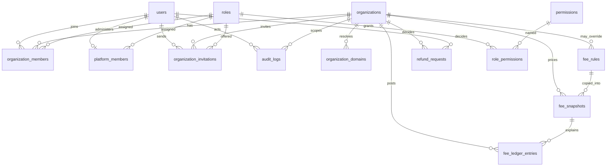

# Phase 1 architecture and implementation plan

Status: the plan in this document is what Phase 1 implements. Later phases are listed in [BACKLOG.md](BACKLOG.md) and are not built here.

ReserveWorx (`mymediaworx/reserveworx`) was readable. Its tenancy, membership gates, tenant-bound sign-in, sync command, fee snapshots, and CI shape were adapted to organizations and events. The code was not vendored. DistroSKU was not consulted.

## Hosting compatibility

Target for early testing: SiteGround GoGeek, conventional PHP request/response. Production hosting is undecided, so nothing here requires SiteGround-only APIs.

| Constraint | How Phase 1 fits |
|---|---|
| PHP 8.2+ | `composer.json` requires `php: ^8.2`. The lockfile is solved with platform PHP 8.2.35 so a newer local CLI cannot pull 8.3-only packages. Laravel 12 supports PHP 8.2. |
| MySQL InnoDB, PDO | Default connection is MySQL. The mysql and mariadb connections set `engine` to InnoDB. |
| No mandatory Docker, Node, Redis, workers, or WebSockets | Runtime assets are `public/css/worxevents.css` and `public/js/worxevents.js`. Cache, session, and queue default to the database. |
| Cron plus a short database queue | `routes/console.php` schedules `queue:work database --stop-when-empty --tries=3 --max-time=20` every minute. The table is `background_jobs`. |
| About 600k inodes | [DEPLOY.md](DEPLOY.md) keeps the current release and one previous release, prunes caches, views, logs, and keeps two backups. |
| About 768MB PHP memory | Pagination is capped at 100. This memory figure was measured on a sibling GoGeek site, not on WorxEvents. See [HOSTING.md](HOSTING.md). |
| Secrets outside the web root | Deploys read `laravel/shared/.env`. `public_html/index.php` only boots the current release. |
| Locked entry scripts | `public/.htaccess` denies every PHP file except `index.php`. |
| curl receives HTTP 202 | SiteGround's bot check. It is not an application response. Do not use a laptop curl as proof the site is up. |

Unknowns that block a production claim are in [HOSTING.md](HOSTING.md). Hosting access for this domain was not available while Phase 1 was built.

## Framework

Laravel 12, Livewire 4, PHPUnit 11, Pint, and Larastan (PHPStan level 5). Mail for password resets and invitations is sent in the request, because a cron job may not exist yet. After cron is installed, the database queue can take later mail.

## Directory structure

```text
app/Authorization/     RoleCatalog, the source of truth for roles
app/Console/Commands/  organization sync, platform admin, hosting check
app/Domain/Fees/      pure fee math, snapshots, ledger
app/Domain/Payments/   gateway interface and disabled adapters
app/Domain/Refunds/    organizer decision, then provider confirmation
app/Http/             controllers and host middleware
app/Livewire/         team roster
app/Models/           tenant-owned records
app/Tenancy/          organization context and global scopes
database/migrations/  versioned schema
docs/                 this plan and the operating guides
public/               front controller, locked htaccess, static css and js
scripts/release.sh    current release plus one rollback
tests/                unit, feature, and the release-script test
```

## Data model

Money is unsigned integer cents. Timestamps are stored in UTC (`config/app.php` timezone is `UTC`). Primary keys are ULIDs. A null `fee_rules.organization_id` is a platform default.



Also present, without tenant ownership: `platform_settings`, `password_reset_tokens`, `sessions`, `cache`, `background_jobs`, `job_batches`, `failed_jobs`.

`fee_rules` has a check constraint `minimum_cents <= maximum_cents`. `fee_snapshots` are unique on `(organization_id, order_key)` and have no `updated_at`. Ledger rows are unique on `idempotency_key`.

## Tenant isolation

The hostname is the tenant.

1. `ResolveHost` runs at the start of the web middleware group, before route-model binding.
2. A host in `PLATFORM_DOMAINS` is the platform. It has no organization. A client-supplied organization id on that host is a mismatch.
3. Any other host must match a verified `organization_domains` row. Unknown hosts are 404. Suspended and terminated organizations are 403.
4. `X-Organization-Id` or an `organization_id` field must equal the host's organization or the response is 403.
5. `OrganizationManager` holds the organization for the request and clears it afterward.
6. `OrganizationScope` adds `where organization_id = ?`. With no organization in context the scope is `where 0 = 1`, so a missing host cannot leak rows.
7. `FeeRuleScope` is the exception: no context sees platform defaults (`organization_id` is null). An organization sees its own rules and those defaults.
8. Sign-in is tenant-bound. Bad credentials are 422. A real user with no membership on that host is 403 and gets no session. A platform admin without an organization membership is 403 on organization routes. An organization member is 403 on `/platform`.
9. `worxevents:organization:sync` applies `config/organizations.php`. That file is empty in git. A hostname listed there is marked verified because the config is trusted, not because DNS was probed.

## Authentication and RBAC

Session guard, `MustVerifyEmail`, CSRF, and login/register/password throttles of 5 per minute. Password resets expire after 60 minutes (`config/auth.php`). Reset and verification compare lengths before `hash_equals`. Login regenerates the session id and the CSRF token. Logout invalidates the session.

Production forces `Secure` cookies even if `SESSION_SECURE_COOKIE` is false. Cookies are `HttpOnly` and `SameSite=lax`.

Roles live in [RBAC.md](RBAC.md). `RoleCatalog` is seeded and locked by tests. `Gate::before` answers permission slugs from the current organization, or from the platform membership when there is no organization. Other abilities fall through to policies.

Invitations store only the SHA-256 of the token, expire in 7 days, and cannot grant `org_owner`. Accepting requires a verified email, the same email, and the invitation's organization must be the host.

Registration on an organization host creates a buyer membership. The user record is global: one password can belong to several organizations. A reset requested on a host where the user has no membership creates no token.

## Booking fee and ledger

The pure service is `BookingFeeCalculator`. The formula, rounding, and required examples are in [FEES.md](FEES.md).

`BookingFeeRecorder` writes one immutable snapshot per order and one `assessed` ledger row. The same order and the same basis return the original snapshot. A different basis throws. A later fee rule does not rewrite old snapshots.

Ledger kinds are `assessed`, `collected`, `owed`, and `remitted`. Balances sum each kind on its own. Phase 1 posts `assessed` only.

## Payments and refunds

Both providers sit behind `PaymentGateway`. The interface has `name`, `isReady`, and `refund`. Checkout is absent on purpose.

Ship Stripe first. Authorize.net comes later behind the same interface. The recommendation and the rejected alternatives are in [PAYMENTS.md](PAYMENTS.md).

`OrganizerRefundWorkflow` has three steps:

1. `request` records the organizer's decision. Status `requested`. Nothing is sent.
2. `submit` calls the gateway. An accepted result becomes `submitted` and stores a provider reference. `completed_at` stays null. An unconfigured or disabled gateway becomes HTTP 409 and the row stays `requested`.
3. `confirm` is the only path to `completed`. The refund must already be `submitted`, and the provider reference must match with `hash_equals`. There is no HTTP route that confirms a refund.

`ProviderResult` throws if a gateway tries to set `completed` to true.

## Pages and design

The page list and tokens are in [PAGES.md](PAGES.md). Free registration checks out on the organization host. Paid checkout is not wired. Box office and check-in remain permission-gated shells.

## Deployment

[DEPLOY.md](DEPLOY.md). `scripts/release.sh` keeps `current` and `previous`, prunes older trees, and refuses a base path that contains `public_html`. `tests/scripts/release_test.sh` covers that behavior. CI does not deploy.

## Migrations and tests

Migrations are versioned under `database/migrations/` and seed roles, platform settings, and the launch fee rule (300 bps, minimum 100 cents, maximum 500 cents, USD, effective 2026-01-01 00:00:00 UTC). Tests use `RefreshDatabase`.

Required fee examples are unit tests with no framework boot. Feature tests cover cross-organization isolation, the role matrix, auth, idempotent snapshots, ledger kinds, and the refund workflow.

CI is `.github/workflows/ci.yml`: Pint, PHPStan level 5, `composer audit`, the release script, and PHPUnit on MySQL 8.4 and MariaDB 11.8. The local run that accompanied this phase used MySQL 8.0.46. That is not a substitute for the CI engines.

## Risks

- A hostname typo in `config/organizations.php` marks that host verified. Review the file before syncing.
- The user table is global. Isolation depends on membership checks and scopes, which the tests cover, not on separate databases.
- Fee and refund policy in [DECISIONS.md](DECISIONS.md) was approved by Michael on 2026-10-26. Tax treatment, buyer-facing wording, and merchant of record remain external reviews.
- Stripe and Authorize.net adapters cannot charge. Turning them on without webhook confirmation would mark money that did not move.
- SiteGround limits for this domain are unverified. A cron that never runs leaves queued work sitting in `background_jobs`.
- Inode pressure returns if a deploy copies `node_modules` or keeps more than two release trees. The script removes `node_modules` from a release and deletes older trees.
